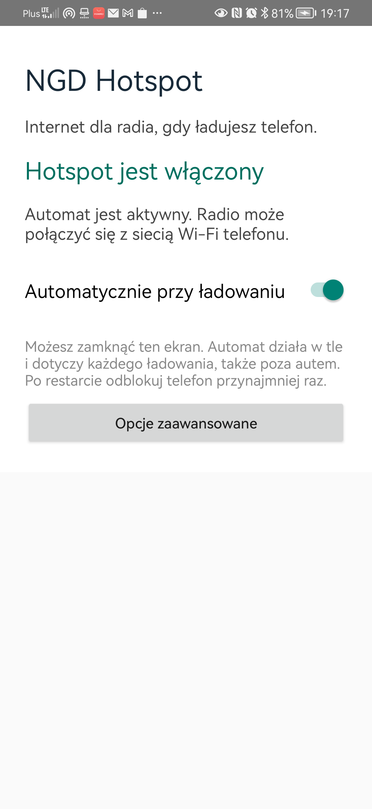

# NGD Hotspot — Android / ładowanie → hotspot

Aplikacja na **telefon z Androidem 8.0+**, niezależna od marki telefonu i od łatki Bluetooth. Udostępnia istniejący hotspot z danych komórkowych podczas ładowania. Radio łączy się z nim przez Wi-Fi. Nie zmienia Bluetooth, USB, nazwy ani hasła sieci.



## Pobranie i zgodność

[NGD-Hotspot.apk](NGD-Hotspot.apk), pakiet `org.nextgendrive.hotspot`, wersja **0.3-simple**. [Suma SHA-256](NGD-Hotspot.apk.sha256) i [wyniki weryfikacji](VALIDATION.json).

Nie ma blokady do Huawei. Minimalna wersja instalacji nie oznacza jednak potwierdzonego działania automatu na każdej wersji Androida. Producent telefonu lub Android może blokować API tetheringu mimo zgody na zmianę ustawień. Ta wersja korzysta z interfejsu tetheringu Androida 10; nie ma jeszcze osobnego backendu dla wszystkich nowszych wydań. Przy `BLOCKED`, `UNSUPPORTED` lub `FAIL` użyj przycisku ustawień hotspotu. To ręczna alternatywa, nie potwierdzenie automatycznego uruchomienia. iPhone/iOS nie obsługuje APK.

Wersję 0.2 zainstalowano jako aktualizację na **P30 Pro / Android 10 / EMUI 12**: zachowała uzbrojenie i uprawnienie, zamknęła stary dziennik sesji i rzeczywiście włączyła hotspot. Usługa działała w tle. Fizyczne odłączenie/podłączenie ładowarki i ponowny rozruch dla tej wersji czekają na test. Innych telefonów i wielogodzinnego uśpienia nie potwierdzono. Wersja 0.1 miała wcześniej potwierdzone uruchomienie przy fizycznym podłączeniu ładowarki.

## Konfiguracja

1. Ręcznie ustaw nazwę i hasło hotspotu oraz włącz dane komórkowe. Aplikacja nie zmienia tych ustawień ani ograniczeń operatora.
2. Zainstaluj APK i otwórz aplikację. Przy aktualizacji tym samym podpisem ustawienia zostają zachowane. Nie wyłączaj globalnie Play Protect.
3. Włącz **Automatycznie przy ładowaniu**. Jeśli potrzeba, aplikacja otworzy jednorazową zgodę na zmianę ustawień. Nadaj ją i wróć do aplikacji. Przyznana wcześniej zgoda pozostaje zachowana.
4. W razie blokady otwórz **Opcje zaawansowane**. W ustawieniach telefonu zezwól aplikacji na autostart i pracę w tle, jeśli wymaga tego producent. Przycisk aplikacji otwiera dostępny panel lub jej informacje systemowe. Na Huawei sprawdź ręczne zarządzanie uruchamianiem: automatyczne uruchamianie, uruchamianie pośrednie i pracę w tle. Aplikacja nie nadaje sobie tych zgód.
5. Pozostaw **Automatycznie przy ładowaniu** włączone. Jeżeli telefon już się ładuje, aplikacja od razu podejmuje próbę uruchomienia hotspotu. Potwierdź jego rzeczywisty stan; samo żądanie startu nie jest sukcesem. Opcjonalny **TEST** w opcjach zaawansowanych ma cofnięcie po około 45 s; uzbrojony automat nie ma takiego limitu.
6. Po rozładowaniu lub restarcie odblokuj telefon PIN-em/hasłem przynajmniej raz. Aplikacja ma obsługę startu systemu i pierwszego odblokowania, ale jej odbiornik nadal może zostać zablokowany przez producenta. W takim przypadku otwórz aplikację, aby wznowić regułę, i sprawdź autostart.
7. Na radiu włącz Wi-Fi, wybierz hotspot, wpisz hasło i zapisz automatyczne łączenie. ADB nie jest potrzebne do codziennego działania aplikacji.

Ekran aplikacji można zamknąć; uzbrojona usługa ma stałe powiadomienie. **Wymuś zatrzymanie** może zablokować automat do ponownego otwarcia aplikacji. Reguła działa przy każdym ładowaniu, również poza autem; nie rozpoznaje zapłonu.

Przy odłączeniu ładowania aplikacja próbuje wyłączyć tylko hotspot uruchomiony przez siebie i przywrócić wcześniejszy stan Wi-Fi z bieżącej sesji. Hotspot włączony wcześniej ręcznie pozostawia bez zmian. Po nowym rozruchu nie przywraca starego stanu Wi-Fi. Ręczna zmiana sieci podczas własnej aktywnej sesji może zostać nadpisana przy jej zamykaniu; sprawdź zachowanie przed codziennym użyciem.

## Wyłączenie i usunięcie

Wyłącz przełącznik **Automatycznie przy ładowaniu**, sprawdź stan sieci, odbierz zgodę zmiany ustawień i odinstaluj aplikację. Nie wymaga roota.

## Źródła i budowanie

`android/` zawiera źródła wersji 0.3. Wersja ta upraszcza główny ekran do statusu i przełącznika, a testy i diagnostykę chowa w opcjach zaawansowanych. Mechanizm usługi i startu systemu pozostał bez zmian względem 0.2. Instalację aktualizacji, zachowanie uzbrojenia, aktywny hotspot i wygląd ekranu potwierdzono na P30 Pro; nie jest to nowy test zimnego startu ani cyklu ładowarki. `tests/BootRecoveryPolicyTest.java` sprawdza rozróżnianie rozruchów, odzyskiwanie wyłącznie po potwierdzonym AP OFF, ochronę niepotwierdzonego hotspotu i limit ponowień. Testy przeszły; nie zastępują testu restartu telefonu. Diagnostyka własnego stanu korzysta z trybu aktywności `AUDIT_ONLY`, bez zatrzymywania usługi przez instrumentation.

Wymagane istniejące AOSP z API29 **system** android.jar, JDK9, aapt2, D8, zipalign i apksigner. To nie jest samodzielny projekt Gradle. Skrypt niczego nie pobiera i nie łączy się z urządzeniem.

```sh
# Ustaw lokalnie NGD_HOTSPOT_KEYSTORE_PASSWORD. Nie zapisuj klucza ani hasła w Git.
python3 build.py --aosp /path/to/aosp --keystore /private/development.p12 --alias ngd-dev --out /tmp/NGD-Hotspot.apk
```

Nie deklarujemy identyczności bajtowej po ponownej budowie. Własny inny podpis wymaga wcześniejszego rozbrojenia i usunięcia poprzedniej instalacji. Repo nie zawiera prywatnych kluczy, haseł hotspotu, kont ani bibliotek OEM.

## English

Android phone companion, **Android 8.0+ installation minimum**, without a Huawei-only restriction. It attempts to start the existing mobile-data hotspot while charging. Android and OEM restrictions can prevent automatic tethering; the installation minimum is not a compatibility guarantee. This version uses the Android 10 tethering interface and does not yet have separate backends for every newer Android release. `BLOCKED`/`UNSUPPORTED`/`FAIL` means automation has not succeeded; the hotspot settings button provides a manual fallback. APK files do not run on iOS.

Version 0.2-bootfix was installed over the previous version on P30 Pro / Android 10 / EMUI 12, preserving permissions and arming. Recovery of a stale journal, actual hotspot activation and a running foreground service were verified. A physical charger cycle and a cold boot with this version are pending. Other phones and extended sleep remain unverified. Version 0.1 previously passed a physical charging-event test.

Configure hotspot credentials and mobile data manually. Grant modify-system-settings access, allow app-specific background operation/autostart where needed, then enable the automatic-while-charging switch. The main screen now shows status and one switch; tests, background settings and diagnostics are under Advanced options. If already charging, it attempts to enable the hotspot immediately. After a reboot, unlock the phone once with its PIN/password. Boot and first-unlock handling are implemented, but OEM startup restrictions still apply; reopening the app resumes the armed rule. The screen may be closed, but do not force-stop the app. A foreground notification remains. TEST rolls back after about 45 seconds; armed operation has no session timer.

The rule applies to every charger. On unplug, it attempts to stop only a hotspot it started and restore the current session's earlier Wi-Fi state; a pre-existing manual hotspot is left unchanged. Old Wi-Fi state is not replayed across reboots. Manual network changes during an owned session may be overwritten on restoration. It changes no Bluetooth, USB, hotspot credentials or mobile-data settings, and needs no root or daily ADB connection. Turn off the automation switch and verify network state before uninstalling.

Version **0.3-simple** changes the UI only: its service and boot receiver are unchanged from 0.2. Updating the phone preserved arming and the active hotspot; the simplified screen was verified on P30 Pro. This is not a new cold-boot or charger-cycle test. Sources and policy tests are included. Build with the existing AOSP Android 10 system SDK/toolchain and a private signing key using the command above. No OEM libraries, private keys or user credentials are distributed. See VALIDATION.json for evidence boundaries.
