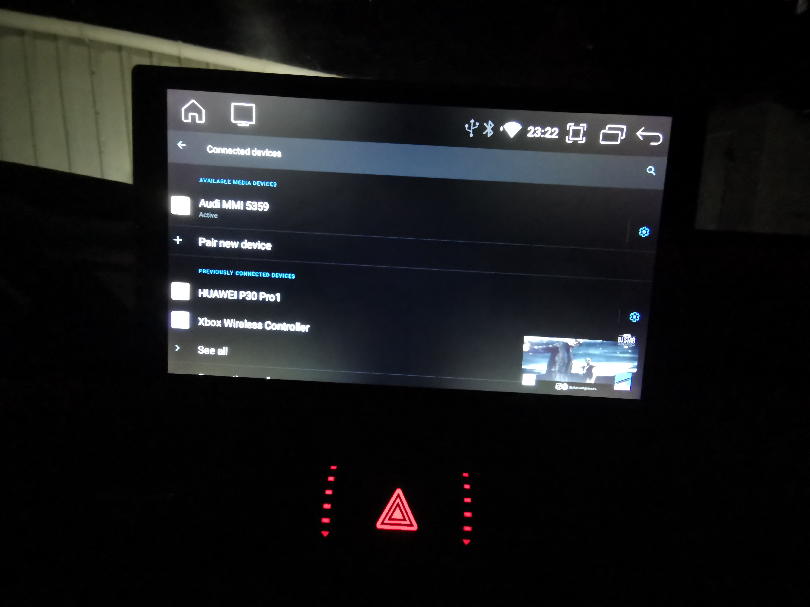
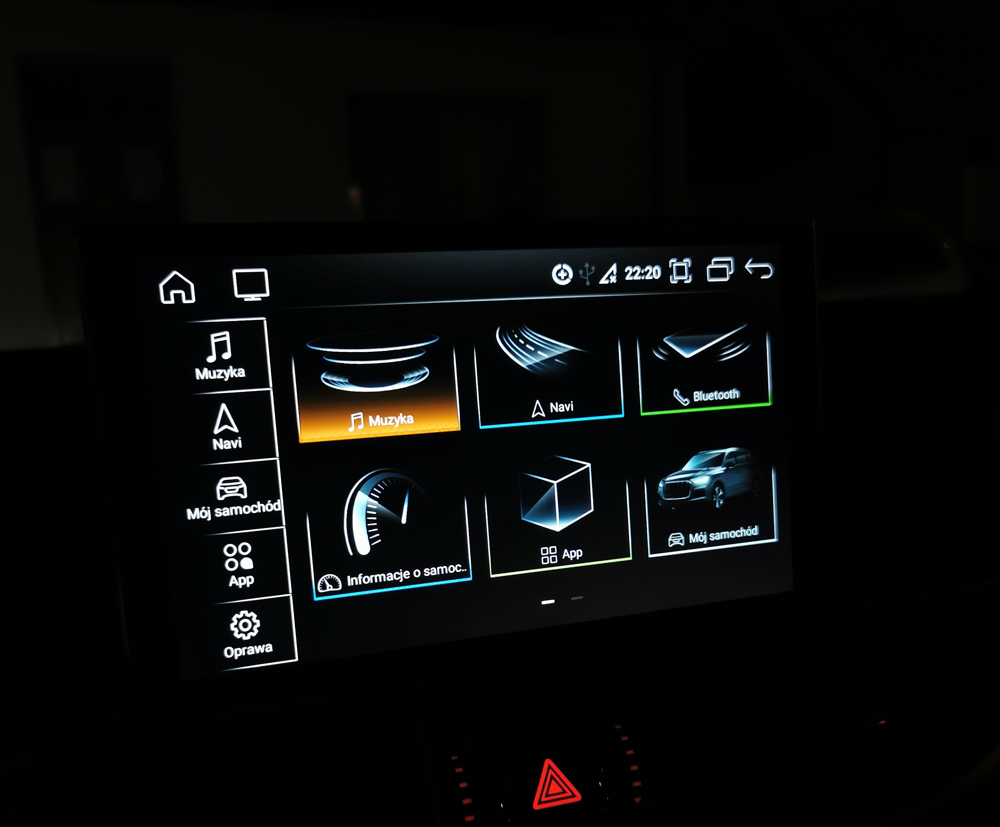
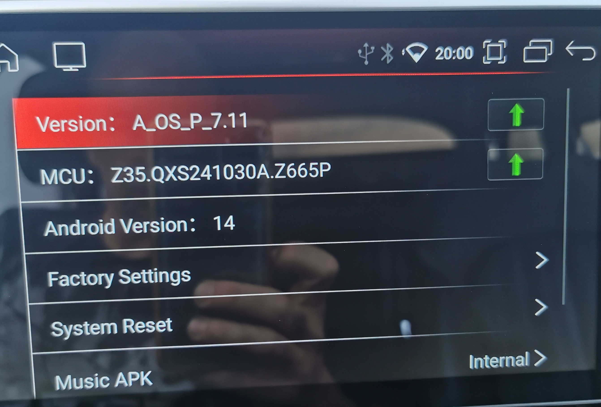
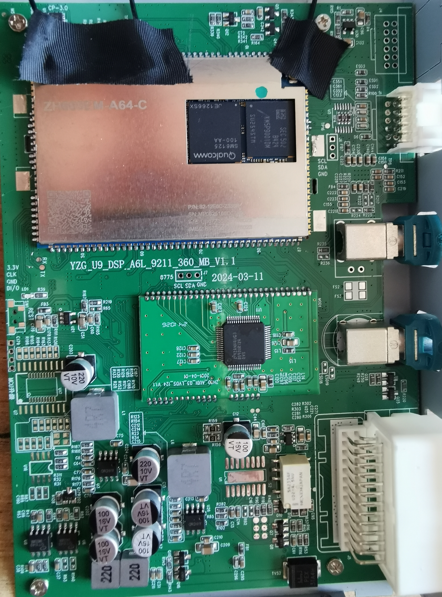
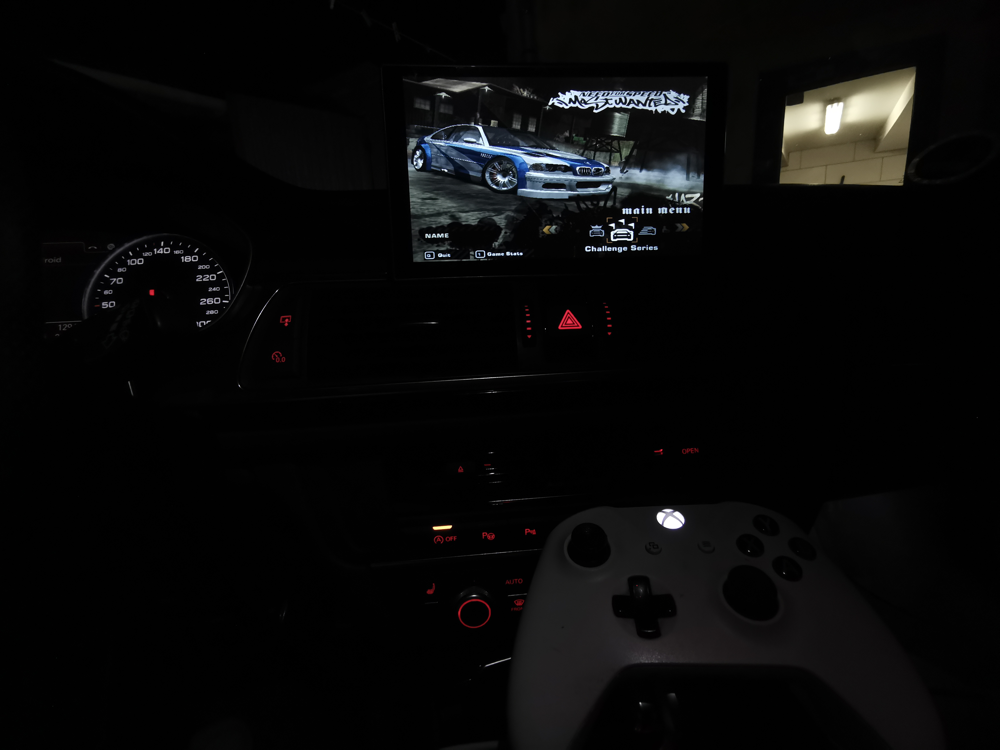

# Zdjęcia jednostki i testów / Head unit and testing photos

Pięć zdjęć udostępnione przez właściciela projektu. Pokazują konkretną jednostkę i stanowisko testowe; nie potwierdzają zgodności innych urządzeń ani samodzielnie nie dowodzą transmisji dźwięku. / Five photographs supplied by the project owner, showing the reference unit and test setup. They do not establish compatibility of other units or prove audio transport on their own.

## Urządzenia Bluetooth w Androidzie / Android Bluetooth devices

Audi MMI 5359 jest oznaczone jako aktywne urządzenie multimedialne. Huawei P30 Pro i pad Xbox są widoczne wśród wcześniej połączonych urządzeń. / Audi MMI 5359 is shown as the active media device. Huawei P30 Pro and the Xbox controller appear among previously connected devices.

## Ekran główny / Home screen

## Informacje producenta / Vendor version screen

Ekran producenta pokazuje „Android Version: 14”. W tym projekcie wersję systemu ustalono osobno jako Android 10 / API 29; oznaczenie w tym menu nie zastępuje kontroli zgodności instalatora. / The vendor screen displays “Android Version: 14”. This project's system was independently identified as Android 10 / API 29; the menu label does not replace installer compatibility checks.

## Płyta główna / Mainboard

Fotografia podzespołów jednostki. Sam wygląd płyty nie gwarantuje zgodności łatki. / Photograph of the unit's components. Board appearance alone does not guarantee patch compatibility.

## Pad Xbox i gra na radiu / Xbox controller and game on the head unit

Zdjęcia użytkownika są materiałami ilustracyjnymi, odrębnymi od licencji kodu Apache-2.0. / User-provided photographs are illustrative materials, separate from the Apache-2.0 source-code licence.
